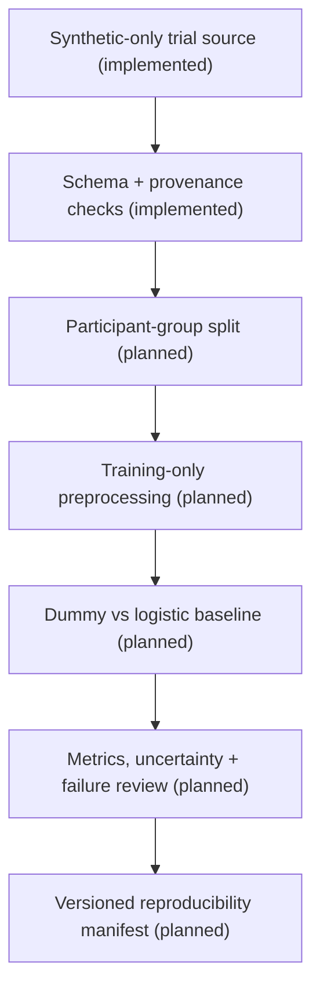

# PsychNeuro OpenBench

> **What if a behavioral ML benchmark could explain not just *how well* a model scored, but also exactly *what it was allowed to learn from*?**

PsychNeuro OpenBench is an emerging **nonclinical, reproducibility-first benchmarking workbench** for behavioral psychology and computational neuroscience research. It is being built for people who want to move from trial tables to defensible model comparisons—without leaking the same participant across training and test data, mistaking post-response measurements for predictors, or losing track of dataset rights.

**Current stage: private engineering preview, not a finished benchmark, published package, or usable browser app.** The available code generates and validates fully fictional behavioral trials. It does **not** yet train or compare ML models.

[Start with the synthetic example](#try-the-current-synthetic-foundation) · [What works today](#what-works-today) · [Scientific contract](docs/spec-v0.md) · [Research and engineering roadmap](#roadmap-with-real-issue-tracking) · [Release requirements](docs/release-gates.md)

---

## The problem worth solving

Imagine two labs publish models that predict trial correctness. One lab makes row-random train/test splits while participants each contribute dozens of trials; another uses a group-held-out split. One lab includes reaction time—the response has already happened—as a feature. Both report strong accuracy.

**Those results are not directly comparable.** A score alone cannot reveal whether the evaluation used independent participants, whether predictors existed at decision time, or whether the exact data and configuration can be reconstructed.

The intended OpenBench workflow makes those decisions inspectable: identify what the dataset is, reject invalid or unauthorized inputs, freeze the participant-level split, run transparent baselines, report uncertainty and limitations, and export a replayable evidence record.

This is a *research-software problem*, not a clinical prediction product. The initial milestone uses synthetic fixtures to test the software contract before considering lawful real research datasets.

## Who it is for

| Research role | What they should eventually be able to do |
| --- | --- |
| **Psychology methods student** | Understand why a good-looking score can be wrong; compare baselines on identical held-out groups |
| **Research assistant / data steward** | Check trial identifiers, source rights, missingness and transformation history before analysis |
| **Computational neuroscience analyst** | Stress-test participant-level generalization and trace the provenance of derived behavioral features |
| **ML reproducibility reviewer** | Inspect exact split identities, versions, metrics, warnings and hosted test evidence without trusting a notebook screenshot |

These are **intended users**, not evidence of interviews, adoption or institutional partnerships.

## What works today

| Component | Current reality | Evidence |
| --- | --- | --- |
| Synthetic two-choice trial generator | **Implemented** — local seeded RNG, invented participants, bounded trial count | [Source](src/psychneuro/synthetic.py) |
| Structural checks | **Implemented** — duplicate keys, trial order, finite values, binary labels and response consistency | [Tests](tests/test_synthetic.py) |
| Portable tabular export | **Implemented** — stable-column UTF-8 CSV and SHA-256 of exact serialized bytes | [Schema](docs/data-schema.md) |
| Dataset card | **Implemented** — synthetic origin, seed, rights declaration, row/group counts and feature availability | [Source](src/psychneuro/synthetic.py) |
| Engineering verification | **Verified for the existing main-line generator:** 31 pytest cases passed; Ruff passed; strict mypy passed on two source files | [Actual Actions log](https://github.com/aradmanamnaoon/psychneuro-openbench/actions/runs/38863471313) |
| Group-held-out baseline benchmarking | **Not implemented** | [Leakage issue #3](https://github.com/aradmanamnaoon/psychneuro-openbench/issues/3), [baseline issue #4](https://github.com/aradmanamnaoon/psychneuro-openbench/issues/4) |
| Real dataset registry, browser UI, third-party reproducibility study | **Not implemented / not validated** | [Rights issue #5](https://github.com/aradmanamnaoon/psychneuro-openbench/issues/5), [manifest issue #6](https://github.com/aradmanamnaoon/psychneuro-openbench/issues/6) |

**Important distinction:** passing unit tests on invented records validates specific engineering behaviors, **not** research impact, statistical generalizability or brain/behavior modeling accuracy.

## From trials to trustworthy comparisons



**Design commitments**

1. **Participants are the unit of independence.** Repeated trials from the same synthetic participant must not cross training, validation and test boundaries when participant generalization is claimed.
2. **No tomorrow's information in today's prediction.** For correctness predicted before a response, `response`, `response_time_ms`, outcome-derived summaries and identifiers are not permissible predictors.
3. **A dummy model belongs in the report.** A classifier should not be called useful merely because it beats no baseline.
4. **Rights are part of the experiment.** A software license does not grant permission to use a dataset; unverified real datasets are denied by default.
5. **A failure is evidence.** An invalid input, insufficient group count, undefined metric or unreproducible run should produce an explicit failure—not a fabricated number.

The normative research and reproducibility proposal lives in [`docs/spec-v0.md`](docs/spec-v0.md). That document remains subject to review and is **not** proof that the planned benchmark engine already exists.

## Try the current synthetic foundation

The public-facing browser experience is **not available yet**. These steps are for future technical contributors using an independently authorized development environment; the project owner is not expected to install or run anything locally.

**Requirements:** Python 3.11+; no model API, GPU, patient dataset or paid cloud endpoint. The current generator uses only the Python standard library at runtime.

```sh
python -m pip install -e '.[dev]'
python -m pytest -q
python -m ruff check .
python -m mypy src
```

In Python:

```python
from psychneuro.synthetic import (
    SyntheticConfig,
    dataset_card,
    generate_trials,
    to_csv_text,
)

config = SyntheticConfig(
    seed=42,
    n_participants=24,
    trials_per_participant=20,
)
trials = generate_trials(config)
csv_text = to_csv_text(trials)
card = dataset_card(config, trials)

print(f"Rows: {len(trials)}")
print(f"Fictional participants: {card['n_participants']}")
print(f"Synthetic: {card['synthetic']}")
print(f"Input SHA-256: {card['source_sha256']}")
```

With this configuration, the **record-count contract is 24 × 20 = 480 synthetic trials**, subject to successful generation. Each record includes a fictional participant, a session and trial key, pre-response condition/difficulty, synthetic correctness, a generated response, and reaction time in **milliseconds**. The exact digest depends on the code, configuration and runtime; it is calculated instead of hard-coded in this README.

### What a dataset card means

A card records the dataset ID, schema/generator version, seed, row counts, rights basis, raw-export SHA-256, feature definitions and limitations. The current card says `synthetic-original`; it does **not** authorize use of any future real dataset and does **not** establish a software source-code license.

[Read the full field contract](docs/data-schema.md) for keys, units, missing/invalid-value rules and predictor restrictions.

## Reproducibility: what is demonstrated vs still to prove

**Demonstrated in hosted CI for the current generator:** on Python 3.11, [run #38863471313](https://github.com/aradmanamnaoon/psychneuro-openbench/actions/runs/38863471313) reported `31 passed`, `All checks passed!` from Ruff, and `Success: no issues found in 2 source files` from mypy. The validated generator/test blobs were copied onto `main` in [commit `ee9eb00`](https://github.com/aradmanamnaoon/psychneuro-openbench/commit/ee9eb00f2579a95c404d0ba2f332e7a28d7d502d). That is a specific observed CI result, **not** a claim that every future change or every branch passed.

**Not yet demonstrated:** out-of-group ML generalization, train-only preprocessing, baseline score comparison, participant bootstrap intervals, cross-platform replay, real participant privacy controls, or the complete v0 reproducibility manifest. The planned contract calls for repeat runs, explicit input checksums, frozen folds and environment information before those claims become appropriate.

The default-branch [Actions workflow](.github/workflows/ci.yml) is manual-only to avoid recurring private-repository runner use. The verification branch exists separately and is not an automatic release pipeline.

## Project structure

```text
.
├── docs/
│   ├── spec-v0.md           # Scientific scope and acceptance gates
│   ├── data-schema.md       # Trial-level fields, types, units and restrictions
│   ├── license-policy.md    # Software vs dataset rights
│   └── release-gates.md     # Privacy, verification and publication requirements
├── src/psychneuro/
│   ├── __init__.py
│   ├── synthetic.py         # RNG, validation, CSV and dataset card
│   └── py.typed
├── tests/
│   └── test_synthetic.py    # Implemented generator contract tests
├── .github/workflows/ci.yml
├── pyproject.toml
└── README.md
```

The tree above describes the **main branch at this README revision**; independent development branches may have additional material. In particular, a separate multi-session synthetic design was authored on `pm-02/synthetic-foundation` but has **not been substituted for the tested main-line API**.

## Roadmap with real issue tracking

This is intentionally a sequence of acceptance gates, not a feature wish list dressed up as delivered software.

| Milestone | Evidence needed | Issue |
| --- | --- | --- |
| Foundation | Complete schema and rights card validation for synthetic trials | [#1](https://github.com/aradmanamnaoon/psychneuro-openbench/issues/1) |
| Repeatability | Seed, key, edge-case and CSV/hash tests with hosted logs | [#2](https://github.com/aradmanamnaoon/psychneuro-openbench/issues/2) |
| Evaluation integrity | Pairwise-disjoint subject groups, deterministic split digests, negative leakage fixtures | [#3](https://github.com/aradmanamnaoon/psychneuro-openbench/issues/3) |
| Meaningful modeling | Matched held-out folds for DummyClassifier and LogisticRegression, transparent metrics | [#4](https://github.com/aradmanamnaoon/psychneuro-openbench/issues/4) |
| Lawful sources | Deny-by-default permitted-source registry and complete provenance cards | [#5](https://github.com/aradmanamnaoon/psychneuro-openbench/issues/5) |
| Audit-ready replay | Canonical manifest, failure warnings, identical controlled reruns and actual CI logs | [#6](https://github.com/aradmanamnaoon/psychneuro-openbench/issues/6) |

The full envisioned platform may later add an accessible browser workbench, real datasets with verified rights, and external review. **None of those should be described as available before implementation and direct validation.**

## Browser-only reviewer route

For reviewers with access to this **private** repository:

1. Start with the [v0 scientific contract](docs/spec-v0.md) and [schema](docs/data-schema.md).
2. Check the actual [generator implementation](src/psychneuro/synthetic.py), [tests](tests/test_synthetic.py) and the [verified hosted job](https://github.com/aradmanamnaoon/psychneuro-openbench/actions/runs/38863471313).
3. Inspect [rights decisions](docs/license-policy.md), the [development issues](https://github.com/aradmanamnaoon/psychneuro-openbench/issues), and the [release gates](docs/release-gates.md).
4. Treat a missing run, incomplete dataset permission, or missing split/metric evidence as **not verified**.

No login-free interactive browser demo has been deployed. Browser inspection is a **review workflow**, not an actual web-based experiment runner.

## Research ethics, privacy and limitations

- **Synthetic only:** no real psychological-study participant data, clinical records, patient identifiers, diagnosis, treatment, or personalized neuroscience inference are processed in this milestone.
- **No science claims from toy parameters:** accuracy and reaction-time distributions were chosen for software testing, not fitted to human cognitive behavior or externally validated.
- **No claim of BIDS compatibility:** BIDS is an interoperability reference, not a certification of this initial CSV schema.
- **No redistributable software license yet:** this private code remains without an open-source license grant. The rights decision is separate from the generated synthetic data's provenance.
- **No public release or publicity:** do not change repository visibility, publish a release/package/demo, recruit users, or update professional profiles without a finished technical review and explicit owner approval.

See [the release gate checklist](docs/release-gates.md) and [rights policy](docs/license-policy.md).

## Why build this openly *after* verification?

Reproducibility software earns trust from decisions another lab can inspect: the data we were allowed to use, the subjects the model never saw, the baselines it had to beat, and the exact record of what ran. That is the objective of PsychNeuro OpenBench—not a leaderboard of attractive but unauditable scores.

**Development stays private until the agreed acceptance gates pass and the owner explicitly approves publication.** A polished README is preparation for that review, not evidence that the platform is finished.
